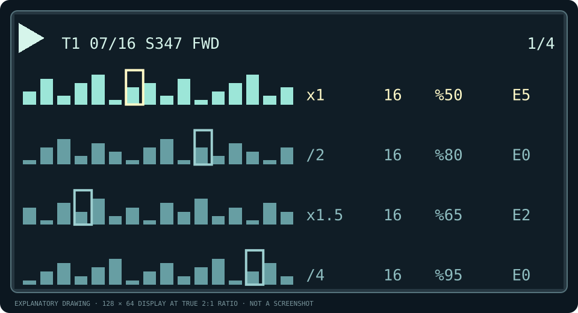
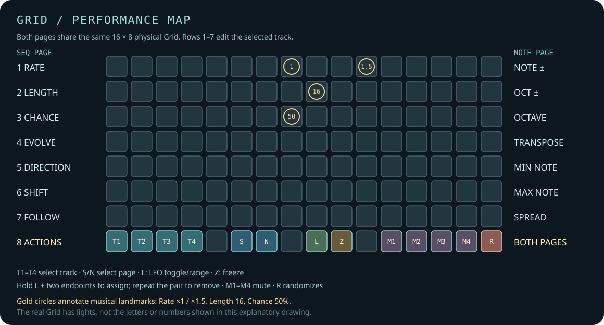
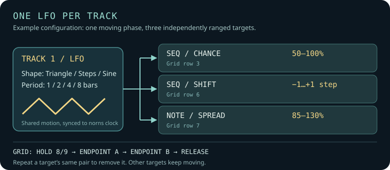

# shoal-norns

Four generative melodies for **norns**, with an optional **16 × 8 Grid** performance editor. Each track grows a repeatable pattern from a seed, then lets you reshape how it moves, changes and sounds. The norns screen shows all four complete patterns and their moving playheads; Grid is for hands-on parameter changes, not a second step sequencer.

> **Credit first:** [Shoal for the disting NT](https://github.com/ormermodular/shoal), the original idea, musical algorithm, name and design, is by **Ormer Modular**. This is an **unofficial norns adaptation**, not an Ormer Modular release. The Lua musical core ports parts of their MIT-licensed C++ source; their copyright and licence are retained in [THIRD_PARTY_NOTICES.md](THIRD_PARTY_NOTICES.md). The norns adaptation, interface and routing are maintained by [@giovannilami](https://github.com/giovannilami).

This is a **community beta**. PolyPerc, MIDI, n.b., Grid interaction, the basic LFO controls and pset save/recall have been exercised on a real norns. Long sessions, extreme rates and some output edge cases still need testing; see [Known differences](#known-differences-and-limits).

## Start playing

1. Download this repository to your computer. For norns, make a `shoal-norns` folder in `/home/we/dust/code/` containing **`shoal-norns.lua`**, the complete **`lib/`** directory (including `shoal_mod.lua`), `LICENSE` and `THIRD_PARTY_NOTICES.md`. Leave `docs/` and `test/` on your computer; norns does not need them to run Shoal. A separately provided runtime-only ZIP contains exactly those device files. If an older Shoal folder exists on norns, first move it out of `dust/code`; do not merge versions.
2. Select **SHOAL-NORNS** on norns. Track 1 plays the built-in PolyPerc engine immediately; Tracks 2–4 start with Output **Off** until you assign them.
3. Turn **E1** to select a track. Turn **E2** for Rate and **E3** for Length. Press **K3** to arm a new seed; it lands at the next loop start. **K2** stops or starts playback.
4. In **PARAMETERS → EDIT → TRACK 1–4**, choose an Output: PolyPerc, n.b., MIDI or crow. The Grid is optional.

If the script does not appear in SELECT after copying it, restart norns. Development checks live in `test/` (singular), which norns excludes from SELECT; an old `tests/` (plural) directory can appear as extra scripts. Do not put a ZIP *inside* `dust/code/shoal-norns`; extract it on your computer first. A `SUPERCOLLIDER FAIL` accompanied by `Structure needs cleaning` or ext4 errors indicates a filesystem problem, not a Shoal Lua error; stop and check the microSD before retrying. See the [publishing checklist](docs/PUBLISHING.md) for the remaining release steps.

## The norns screen

The overview is deliberately a *whole-pattern* view: each row shows every step of that track, whether its Length is 4, 16 or 64. A brighter outline follows the last visited step; short bars represent rests and taller bars suggest note height. The selected track is brighter.

The top line reports the selected track, its current position/length, seed, Follow source when present and Direction. The seed is always **0–999**; `S:419` means seed 419, not 5,419. The four values to the right of each pattern are always **Rate · Length · Chance · Evolve**. The picture above is an explanatory drawing, not a screenshot of a running seed.

**Tide follows the original Shoal behavior:** after each complete pass, pitches move one step against a fixed rhythm. Chance rests and Tie positions stay put, so bar heights can change at the same screen positions without a new seed. The rotation is non-destructive: with Evolve off, it realigns after `Length` passes, and switching to Forwards reads the original unrotated melody. See the [original Shoal manual](https://github.com/ormermodular/shoal/blob/main/docs/MANUAL.md).

| On norns | Action |
| --- | --- |
| E1 | Select track 1–4 on any page |
| E2 / E3 on page 1 | Rate / Length of selected track |
| Hold K1 + E2 / E3 on page 1 | Chance / Evolve |
| K2 / K3 | Play–stop / reseed selected track |
| Hold K1 + K3 / K2 | Next / previous screen page |
| E2 / E3 on pages 2–4 | Choose field / edit value |

Page **1/4** is the performance overview. Page **2/4** edits Seed, Direction, Shift, Follow, Breathe, Gate, Tie and Mute. Page **3/4** edits Note/Oct variation, Octave, Transpose, Min/Max note and Spread. Page **4/4** contains Scale, Root, Weight, Freeze and output settings. The full parameter menu remains available under **PARAMETERS → EDIT**; n.b. voice-specific sound controls live there too.

## Optional 16 × 8 Grid

The Grid has two pages, **SEQ** and **NOTE**, independent of the four norns screen pages. Rows 1–7 set one parameter each. The last row always selects tracks and pages or performs an immediate action.

| Row | SEQ | NOTE |
| --- | --- | --- |
| 1 | Rate | Note variation |
| 2 | Length | Octave variation |
| 3 | Chance | Octave offset |
| 4 | Evolve | Transpose |
| 5 | Direction | Minimum MIDI note |
| 6 | Shift | Maximum MIDI note |
| 7 | Follow | Spread |
| 8 | T1–T4 · SEQ/NOTE · LFO · Freeze · Mutes · Random | Same actions |

Tap a row to choose one of its discrete values. Important landmarks: **Rate ×1 and Chance 50% share column 8; Rate ×1.5 is column 11; Length 16 is column 9.** **Row 8, column 9** controls the LFO. The former Grid Fine function has been removed; use the norns encoders or parameter menu for exact values between Grid choices. **Row 8, column 16** randomizes *all 14 Grid-editable parameters* of the selected track, across both Grid pages. It chooses values reachable from Grid keys, with two performance-friendly limits: **Rate stays between /4 and ×4, and Chance is at least 5%**. You can still set slower/faster rates or Chance 0% manually. Random does not alter Seed, Mute, Freeze or playback. K2 on norns remains Play/Stop.

The Grid intentionally does not duplicate the asynchronous sequencer display. For exact value ladders and the meaning of each control, see the [detailed guide](docs/DETAILED_GUIDE.md).

### Clock-synced LFOs

There is **one LFO per track**. In **PARAMETERS → EDIT → LFO T1–T4**, switch it on, choose **Triangle**, **Random steps**, or **Sine**, and choose a cycle of **1, 2, 4 or 8 bars**. Then switch on any combination of Rate, Length, Chance, Shift, Note ±, Oct ± and Spread. They share the same movement, but each has its own range. Triangle goes low → high → low; Random steps holds one deterministic value for each full cycle; Sine moves smoothly through the range before snapping to available Grid values.

On Grid, **tap row 8, column 9** to turn the selected track's LFO on or off. To set one target's range, **hold 8/9**, press its row at the first endpoint, press the same row at the second endpoint, then release 8/9. This also assigns that target to the LFO. You can set **several rows in one hold**; while still holding 8/9, press **8/6** or **8/7** to change Grid page and add targets there too. Alternatively, release 8/9 and hold it again for the next parameter; this does not switch the LFO off once you have touched a row. For example, on `SEQ`, hold 8/9 and press **8/3 then 16/3** to vary Chance from **50% to 100%**. On `NOTE`, use row 7 for Spread. Lit endpoints bracket the moving bright value. To remove just that assignment, repeat the **same two endpoints** while holding 8/9 (either order); the other LFO targets keep running. The same target can also be switched Off in its `LFO Tn` menu. Column 5 of the bottom row is again an empty separator.

The menu and pset retain the manual/base values; the LFO only changes what plays. Turning the LFO or a target off restores its base value. Rate changes at beat boundaries without restarting the playhead; Length changes at the beginning of the next phrase, not halfway through one. Basic Grid/LFO operation has been tested on a real norns; extended sessions, very high rates, dynamic Length in non-linear Directions and recall of LFO ranges from psets still need hardware checks. [The detailed guide](docs/DETAILED_GUIDE.md#clock-synced-lfo) has the full behavior and examples.

## Sound and connections

| Output | What you need |
| --- | --- |
| PolyPerc | Built in; Track 1's default. A simple percussive sound for first launch. |
| MIDI | Set the global MIDI port to the virtual device slot in **SYSTEM → DEVICES → MIDI**, then set each track's MIDI channel. |
| crow | Use outputs 1/2 or 3/4 as pitch/gate pairs; 0 V is MIDI note 48 (C3), 1 V/octave. |
| n.b. | An installed n.b.-compatible player (via `nbout` or standalone `nb`). Assign a different voice per track if you like; edit the selected voice's sound under **N.B. SOUND** in PARAMETERS → EDIT. |

Each track routes independently. Shoal itself needs no custom SuperCollider engine; an n.b. voice may use its own sound engine. PolyPerc is available as the built-in first-play sound. MIDI and n.b. were tested by the port's user; crow remains a route to verify on hardware.

## Saving and recalling

Use norns' usual **PARAMETERS → PSET** menu. Psets save the script parameters, including seeds, routing, Grid-edited values and LFO settings/ranges. Saving and recalling a pset was tested on hardware before the LFO feature; recall of the new LFO ranges still needs a hardware check. Psets from an earlier development build with all 29 NT Rate options should have their Rate values checked: this norns build exposes `/32` through `×32`, not `/64` or `×64`, so old option numbers can refer to a neighbouring rate.

## Known differences and limits

- The reference core preserves Shoal's eight-track, 29-rate tables for source comparison. The playable norns instrument uses **four tracks** and **27 selectable rates** (`/32` to `×32`).
- **Shift** is an offset in *steps*, not a pitch transpose. The Grid offers selected values up to ±12; the norns parameter menu offers the full ±63. Use Transpose or Octave for pitch changes.
- **Min/Max note and Spread** are norns-only output-pitch controls. They do not change the seed or the reference musical core.
- NT-specific Current CV, Slop timing and exact gate/EOS pulse behavior are not implemented here. Tie handling, very high rates and crow timing need more hardware testing. PolyPerc is percussive, so Freeze cannot sustain it like a held MIDI or n.b. note.
- This is a port and adaptation, **not** a byte-for-byte reproduction of every NT output or interface feature.

See [detailed behavior, fidelity notes and test instructions](docs/DETAILED_GUIDE.md) before reporting an equivalence issue.

## Credits and licence

**Original Shoal:** [Ormer Modular](https://github.com/ormermodular/shoal), for the Expert Sleepers disting NT. Their original [manual](https://github.com/ormermodular/shoal/blob/main/docs/MANUAL.md) is the primary reference. **norns adaptation:** [@giovannilami](https://github.com/giovannilami), with its own interface and output routing. The original author deserves the primary credit for the musical concept and algorithm.

The norns-specific code is offered under the [MIT licence](LICENSE); the original Ormer Modular MIT notice is reproduced in [THIRD_PARTY_NOTICES.md](THIRD_PARTY_NOTICES.md). Contributions and bug reports are welcome once the public repository and lines thread exist. This project is not affiliated with or endorsed by Ormer Modular, Expert Sleepers or monome.
